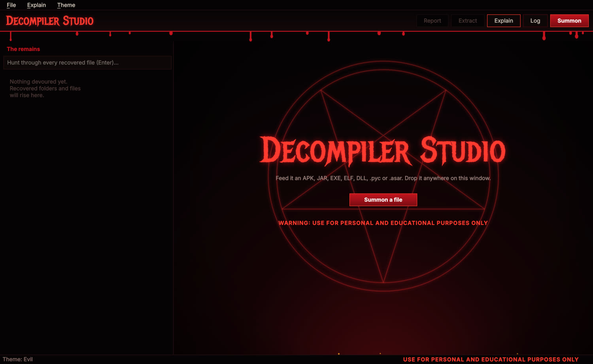
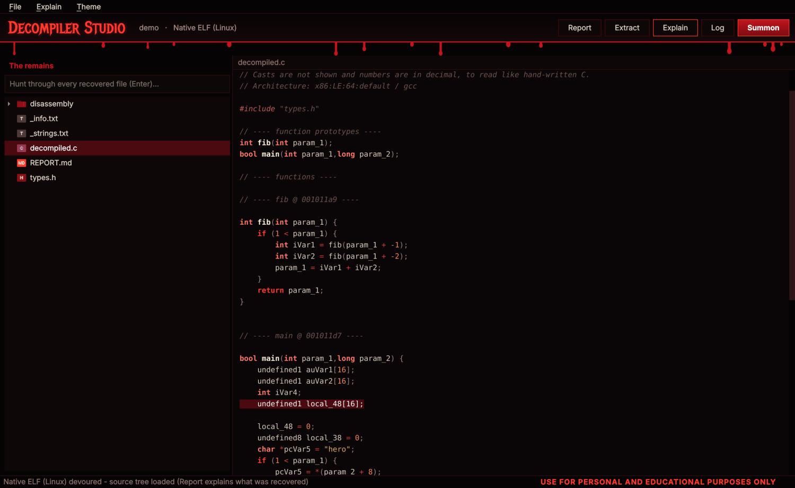
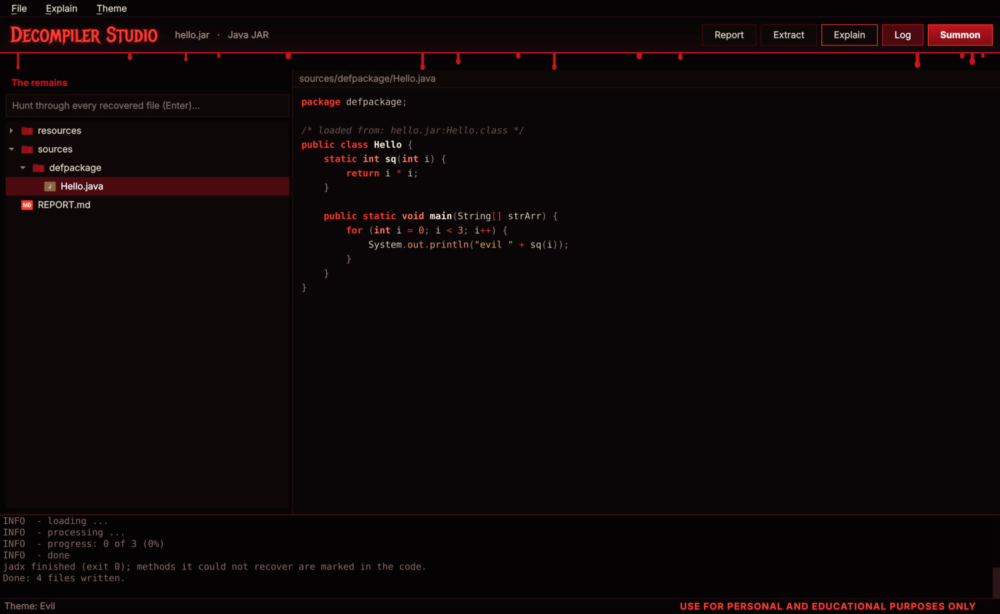
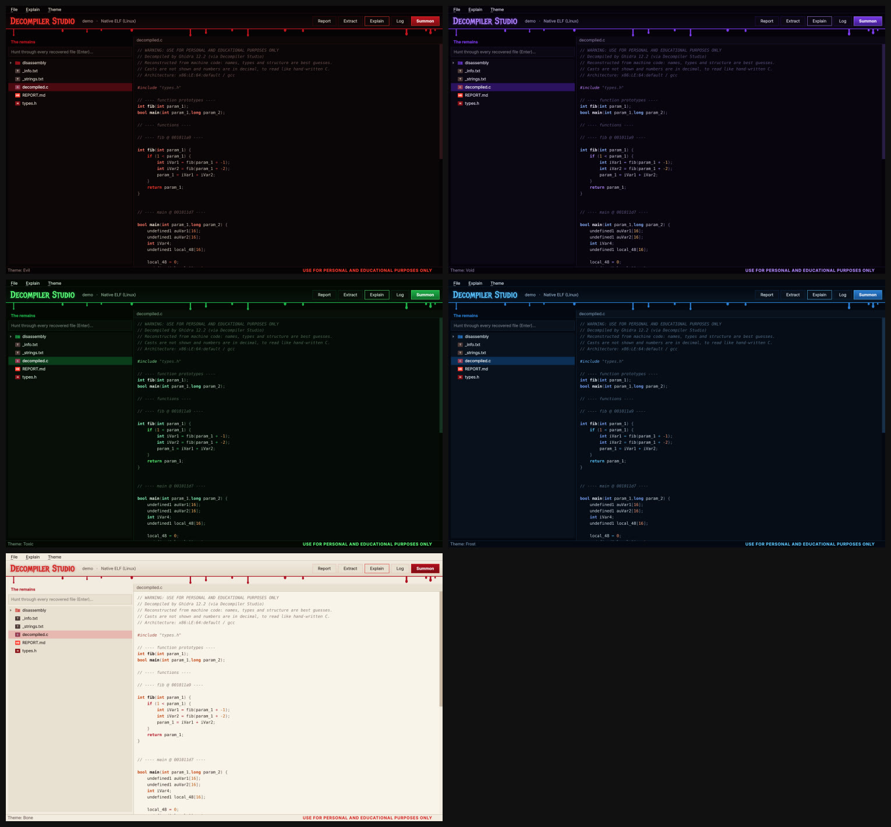

# Decompiler Studio

**Drop in an APK, JAR, EXE or ELF. Get a browsable source tree back.**

> ⚠️ **USE FOR PERSONAL AND EDUCATIONAL PURPOSES ONLY.** Only decompile software you own or have permission to study.



A Linux GUI (PySide6) that wraps real decompilers and puts the result in a folder tree with a syntax-highlighted code viewer:

| You drop in | You get |
|---|---|
| Native programs (ELF, EXE, DLL) | C from **Ghidra**, tidied to read like hand-written C, plus disassembly |
| Android APKs and Java JARs | Java from **jadx**, plus a `maincode/` folder with the app's own code |
| Unity (IL2CPP) games | every class, field, method and parameter name from the game's metadata (`maincode/unity/`) |
| Flutter apps | every text string and Dart file path from `libapp.so` (`maincode/flutter/`), so search finds screen text |
| Python `.pyc`, Electron `.asar` | Python source / unpacked files |
| .NET assemblies | C# if `ilspycmd` is installed, otherwise a list of the types and methods |

Every run also writes a `REPORT.md` that says what was recovered and what to trust.

## Install (Linux x86_64)

```bash
curl -fsSL https://raw.githubusercontent.com/rxvy-dev/decompiler-studio/main/install.sh | bash
```

Then run `decompiler-studio` (or find it in your app menu).

- Needs `python3` (3.9+ with `venv`), `git` and `curl`. No root, nothing system-wide.
- Downloads jadx, a Java 25 runtime and Ghidra from their official GitHub releases (about 600 MB) into `~/.local/share/decompiler-studio`.
- Run the same command again to update. Remove it with:

```bash
curl -fsSL https://raw.githubusercontent.com/rxvy-dev/decompiler-studio/main/install.sh | bash -s -- --uninstall
```

Prefer to read a script before running it? [install.sh](install.sh) is short.

Windows: the GitHub Actions workflow builds a Windows version, or run from source (`pip install -r requirements.txt`, put jadx / Java 25 / Ghidra under `backends/`, `python app.py`).

## What it looks like

Native code, decompiled to C:



Java from a JAR/APK, with the progress log open:



### Themes

**Midnight** is the default. Graphite, Forest, Violet and Daylight (light) are in the **Theme** menu, and your choice is remembered.



## Features

- **C that reads like C.** Casts hidden, decimal numbers, `x * 1.0` and stack-protector noise removed, variables declared where first used, `for (int i = 0; ...)` loops restored. Without debug info the names stay generic (`param_1`, `iVar3`): build your own programs with `-g -O0` to get your real names back.
- **`maincode/` for APKs.** The app's own packages, picked out from thousands of library files.
- **Native libraries inside APKs.** Double-click any `.so` (or `.dll`/`.exe`) in the file tree, or right-click > *Decompile this binary* (Ctrl+D): Ghidra turns it into C under `native/`. ARM64, ARM and x86 all work. Big ones (like `libapp.so`) can take 10-25 minutes.
- **Unity asset files.** Click a `sharedassets*.assets` / `level*` / `.bundle` file and press **Extract assets**: textures and sprites as PNG, sounds as WAV, models as OBJ, text, fonts and script data as JSON, in `unity_assets/`. `.split0`, `.split1`, ... pieces are joined automatically (uses [UnityPy](https://github.com/K0lb3/UnityPy)).
- **Built-in viewers.** Click an extracted file to see or hear it: images (zoom, pan, transparency, pixel colour under the cursor), sounds (waveform, play/pause, click to seek; plays through `pw-play`/`paplay`/`ffplay`), 3D models (`.obj`, rotate/zoom/wireframe), fonts.
- **Hex viewer for every binary.** Whole file, an entropy strip that shows packed or encrypted regions (click it to jump), a data inspector (u8 to f64 of the byte under the cursor), **Ctrl+G** to go to an offset. Search hits inside binaries open here, highlighted.
- **File info** (**Ctrl+I**): type, architecture, size, MD5 / SHA-1 / SHA-256, entropy verdict, with a Copy button.
- **Code navigation.** **Ctrl+G** lists every function (all 27,000 of a split decompile) with a filter; double-click or Ctrl+click a function name like `FUN_006a508c` (or press **F12**) to jump to it, **Alt+Left** to go back.
- **Code without symbols.** Libraries with no function names (Flutter's `libapp.so`, stripped `.so` files) are searched for function starts, so Ghidra still has code to decompile; huge results are split into `decompiled/part_NNN.c`.
- **Unity + Flutter.** Their real code is compiled native code, so the app reads the names and strings that survive in it (names only, no method bodies).
- **Explain.** Select some code and press **Ctrl+E**: a small *local* AI model explains it in plain English. Nothing is bundled and nothing leaves your computer. Setup: install [Ollama](https://ollama.com), run `ollama pull qwen2.5-coder:1.5b`. Any OpenAI-style local server works too (Explain menu > Server address). Small models can be wrong; treat it as a hint.
- **Split APKs.** If `split_config.*.apk` files (or an `.xapk`/`.apkm`/`.apks`) sit next to `base.apk`, they are merged automatically so native code and assets are included.
- **Hunt** through every recovered file at once (text inside binary files too), drag and drop anywhere, big files open without freezing.
- Never runs the program you open. It only reads it.

## Honest limits

- Decompiling cannot bring back what the compiler threw away: comments, original variable names (without `-g`), struct layouts, R8/ProGuard-obfuscated names (`a`, `b`, `a0`).
- Ghidra's output is a best guess. `in_stack_...` variables are arguments Ghidra could not place in the signature.
- macOS has no Ghidra decompiler binary, so native files fall back to assembly there.

## Build a standalone binary

```bash
pip install pyinstaller -r requirements.txt   # and put jadx, jre, ghidra under backends/ (see .github/workflows/build.yml)
python -m PyInstaller --noconfirm --onedir --windowed --name decompiler-studio \
  --add-data "backends/jadx:backends/jadx" --add-data "backends/jre:backends/jre" --add-data "backends/ghidra:backends/ghidra" \
  --hidden-import theme --hidden-import unpackers --hidden-import tidy --hidden-import il2cpp \
  --hidden-import llm --hidden-import helper_blob --hidden-import unity_assets --hidden-import viewers --collect-all UnityPy --collect-all fmod_toolkit --collect-all texture2ddecoder --collect-all etcpak --collect-all astc_encoder --collect-all tpk_ar --collect-all archspec --collect-submodules decompyle3 --collect-submodules uncompyle6 \
  --collect-all xdis --collect-all dnfile app.py
```

## License

Decompiler Studio is free software, released under the **GNU General Public License v3.0 or later** (see [LICENSE](LICENSE)). You may use, study, share and change it; if you distribute a modified version, it must stay under the GPL with its source available. There is no warranty.

Bundled/downloaded tools keep their own licenses: Ghidra and jadx (Apache-2.0), Temurin JRE (GPLv2 + Classpath Exception), PySide6 (LGPL-3.0), decompyle3 / uncompyle6 (GPL), UnityPy (MIT).

## Credits

[Ghidra](https://ghidra-sre.org) (NSA, Apache-2.0), [jadx](https://github.com/skylot/jadx) (Apache-2.0), Temurin JRE, decompyle3 / uncompyle6, [UnityPy](https://github.com/K0lb3/UnityPy) (MIT).
